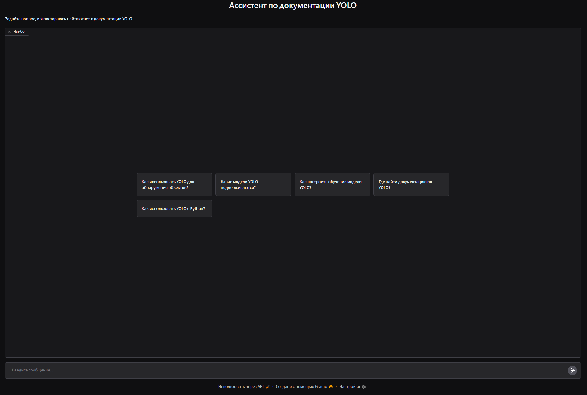

<div align="center">

# RAG-система для документации YOLO

**Гибридный поиск, роутер, реранкер**


</div>

## 📖 О проекте

Локальный RAG-ассистент по экосистеме Ultralytics YOLO, объединяющий поиск по официальной документации и исходному коду (Python и C++).

- **Маршрутизация запросов:** LLM определяет, куда отправлять вопрос - в код, документацию или в оба источника, экономя время и контекст.
- **AST-чанкинг:** Код разбивается по функциям и классам с помощью `tree-sitter`.
- **Гибридный поиск + RRF:** Слияние векторного поиска и BM25. RRF исключает высокие рейтинги от BM25 для кода.
- **Cross-Encoder реранкинг:** Пересортировка кандидатов перед подачей в контекст LLM.
<div align="center">



</div>

## 🤖 Стек
- **LLM:** Qwen3.5-4B-UD_Q5-K-XL
- **Эмбеддер:** Qwen3-Embedding-0.6B
- **Реранкер:** Qwen3-Reranker-0.6B
- **Векторная БД:** ChromaDB
- **Полнотекстовый поиск:** BM25 (rank-bm25)
- **Парсинг кода:** tree-sitter (c++, python)
- **Интерфейс:** Gradio

**Требования к железу:** Проект протестирован на NVIDIA RTX 4070 SUPER (12 GB VRAM). Для инференса LLM и построения индексов настоятельно рекомендуется наличие дискретной видеокарты.

## ⚒️ Установка

1. Установить зависимости:
   ```
   pip install -r requirements.txt
   ```

2. Установить Ollama и модель:
    - Скачать веса [unsloth/Qwen3.5-4B-GGUF](https://huggingface.co/unsloth/Qwen3.5-4B-GGUF)
    - Создать папку с .GGUF и файлом Modelfile с текстом 
    ```bash
    FROM ./путь_к_файлу/model-name.gguf
    ```
    - Импортировать модель в Ollama:
    ```bash
    ollama create qwen3_5 -f ./Modelfile
    ```

3. Скачать документацию и построить индексы:
   ```python
   python src/updateData.py
   ```

4. Запустить веб-интерфейс:
   ```python
   python src/main.py
   ```

## ⚙️ Структура
- `src/main.py` - RAG-пайплайн + Gradio
- `src/router.py` - LLM-маршрутизатор запросов
- `src/ast_chunker.py` - AST-парсер кода
- `src/ingest_data.py` - чанкинг и загрузка в ChromaDB
- `src/ingest_code.py` - индексация кода в ChromaDB и BM25
- `src/ingest_bm25.py` - построение BM25-индекса
- `src/updateData.py` - скачивание документации и построение индексов
- `src/metrics.py` - Генерация тестового датасета и расчёт метрик
- `metrics/` - ground_truth и таблицы с результатами

## 🧮 Метрики

Лучший результат - RRF + rerank (score>=0) с роутером (Recall: 0.633, MRR: 0.594 при 7 чанках в LLM)

## 🔧 Настройка поиска в `main.py` (`hybrid_search()`)
- `n_results` - количество чанков для поиска
- `mode` - алгоритм слияния: `"rrf"`, `"concatenate"`, `"score"`, `"vector"`, `"bm25"`
- `use_reranker`: `True` / `False` - параметр использования реранкера
- `score_threshold`: `None` / `k` - отсечение по скору реранкера (по умолчанию: 0). Если `None`, используется `top_k`.
- `top_k` - количество чанков после реранкера (по умолчанию: 8)
- `rerank_k` - количество чанков до реранкера
- `db_target` - выбор целевой базы данных ("docs" или "code")

### Стандартная настройка
`main.py` использует следующие параметры поиска по умолчанию (`routing()`):
- `n_results`: 25 (docs)
- `n_results`: 15 (code)
- `mode`: rrf
- `use_reranker`: True
- `score_threshold`: 0
- `top_k`: 8
- `rerank_k`: 20