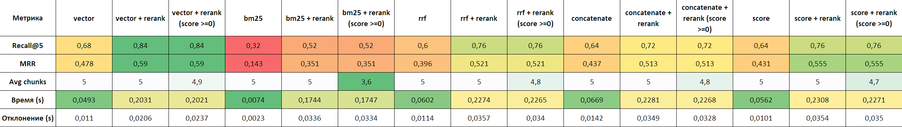

# RAG-система для документации YOLO

Retrieval-Augmented Generation для поиска по официальной документации Ultralytics YOLO.

## Стек
- LLM: Qwen3.5-4B-UD_Q5-K-XL
- Эмбеддер: Qwen3-Embedding-0.6B
- Реранкер: Qwen3-Reranker-0.6B
- Векторная БД: ChromaDB
- Полнотекстовый поиск: BM25 (rank-bm25)
- Интерфейс: Gradio

## Установка

1. Установить зависимости:
   `pip install -r requirements.txt`

2. Установить Ollama и модель:
    - Скачать https://huggingface.co/unsloth/Qwen3.5-4B-GGUF
    - Создать папку с .GGUF и файлом Modelfile с текстом 
    ```
    FROM ./путь_к_файлу/model-name.gguf
    ```
    - Импортировать модель в Ollama:
    `ollama create qwen3_5 -f ./Modelfile`

3. Скачать документацию и построить индексы:
   `python src/updateData.py`

4. Запустить веб-интерфейс:
   `python src/main.py`

## Структура
- `src/main.py` - RAG-пайплайн + Gradio
- `src/ingest.py` - чанкинг и загрузка в ChromaDB
- `src/ingest_bm25.py` - построение BM25-индекса
- `src/updateData.py` - скачивание документации и построение индексов
- `src/metrics.py` - Генерация тестового датасета и расчёт метрик
- `metrics/` - ground_truth и таблицы с результатами

## Метрики


Оптимальным значением параметров является: `reranker_k = 15, score>=6`, данная конфигурация демонстрирует значения Recall: 0.8 и MRR: 0.559 при AVG chunks: 5.6
Подробнее в `metrics/sweep_metrics.xlsx (таблица 2)`
## Настройка поиска в `main.py` (`hybrid_search()`)
- `n_results` - количество чанков для поиска
- `mode`: `"rrf"`, `"concatenate"`, `"score"`, `"vector"`, `"bm25"`
- `use_reranker`: `True` / `False` - параметр использования реранкера (топ-15 кандидатов)
- `score_threshold`: `None` / `k` - отсечение по скору реранкера (По умолчанию - выключено (`None`) - используется top-k (5). `k` - значение для отсечения)
- `top_k` - количество чанков после реранкера
- `rerank_k` - количество чанков до реранкера

### Стандартная настройка
`main.py` использует следующие параметры поиска по умолчанию (`rag_query()`):
- `n_results`: 25
- `mode`: score
- `use_reranker`: True
- `score_threshold`: 0
- `top_k`: 5
- `rerank_k`: 15